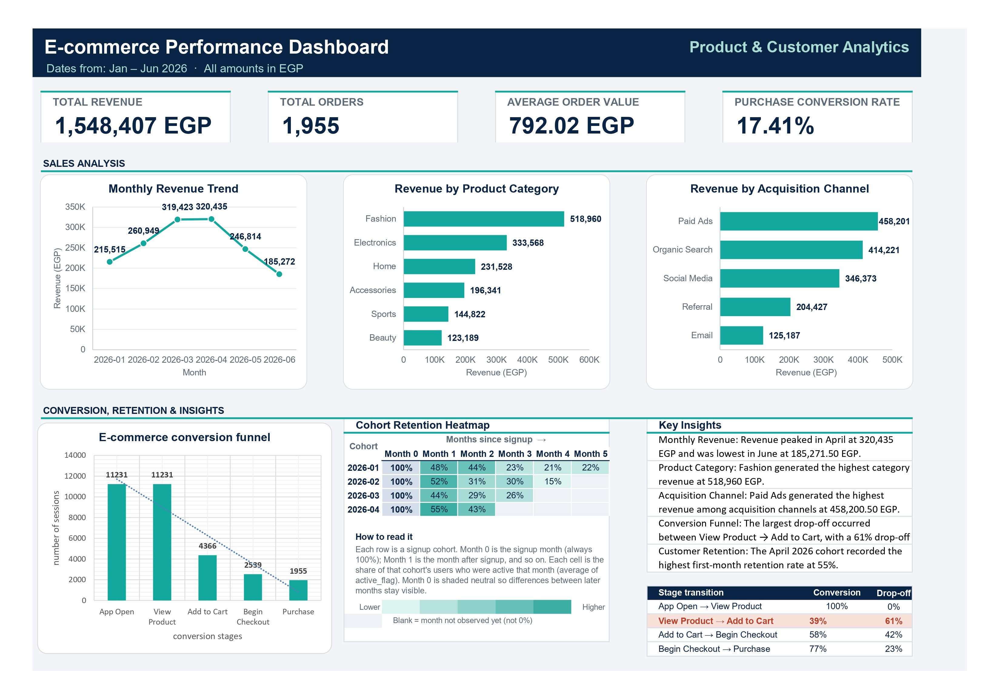

# E-commerce Performance Analysis | Microsoft Excel

## Project Overview

This project presents an end-to-end e-commerce data analysis using Microsoft Excel, supported by an interactive dashboard designed to monitor business performance, analyze customer behavior, and identify opportunities for growth.

The project uses an expanded synthetic e-commerce dataset containing **3,500 customers** and six months of business activity (January–June 2026).

The analysis covers sales performance, revenue trends, product categories, customer acquisition channels, purchasing behavior, conversion rates, and customer retention patterns.

## Project Objectives

- Analyze overall e-commerce performance and monthly revenue trends.
- Monitor key business performance indicators (KPIs).
- Evaluate revenue performance across different product categories.
- Compare revenue contributions from customer acquisition channels.
- Analyze customer progression throughout the purchasing journey.
- Identify conversion drop-off points and potential improvements.
- Measure customer retention over time using cohort analysis.
- Present key business insights through an interactive Excel dashboard.

## Dataset Overview

The expanded dataset includes the following main tables:

| Dataset | Records |
|---|---:|
| Customers | 3,500 |
| Sessions | 11,231 |
| Orders | 1,955 |
| User Monthly Activity | 15,603 |

**Reporting Period:** January – June 2026

## Key Performance Indicators (KPIs)

- Total Revenue
- Total Orders
- Average Order Value (AOV)
- Purchase Conversion Rate

## Dashboard Preview

The interactive dashboard brings together the main business performance indicators and visualizations in one place.

## Dashboard Visualizations

- **Monthly Revenue Trends:** Tracks revenue performance across the six-month reporting period.
- **Revenue by Product Category:** Compares revenue generated by different product categories.
- **Revenue by Acquisition Channel:** Evaluates the contribution of different customer acquisition sources.
- **Sessions by Conversion Stage:** Visualizes customer progression from app opening to completed purchase and highlights drop-off points.
- **Customer Cohort Retention Heatmap:** Tracks customer activity across different signup cohorts and subsequent months.
- **Key Business Insights:** Highlights important findings from sales, acquisition, conversion, and retention analysis.

## Analysis & Key Findings

- **Sales Performance Analysis:** Examined monthly revenue trends, identified peak and low-performing months, and evaluated changes in sales performance.
- **Product Category Analysis:** Identified Fashion and Electronics as the leading revenue-generating categories.
- **Acquisition Channel Analysis:** Compared revenue contributions across Paid Ads, Organic Search, Social Media, Referral, and Email.
- **Conversion Funnel Analysis:** Evaluated session progression through different purchasing stages and identified the largest customer drop-off.
- **Cohort & Retention Analysis:** Grouped customers by signup month and tracked their activity over subsequent months to understand retention patterns.
- **Business Performance Analysis:** Translated dashboard findings into actionable insights and recommendations.

## Tools & Skills

- Microsoft Excel
- Data Analysis
- Data Preparation
- Excel Tables
- PivotTables
- Excel Formulas
- KPI Calculation
- Sales Performance Analysis
- E-commerce Analytics
- Conversion Funnel Analysis
- Customer Cohort Analysis
- Customer Retention Analysis
- Data Visualization
- Interactive Dashboard Design
- Conditional Formatting

## Project Files

- `Ecommerce_Dashboard.xlsx` – Excel workbook containing the expanded dataset, analysis worksheets, KPI calculations, and interactive dashboard.
- `Report.pdf` – Detailed report covering project objectives, analysis, key findings, and business recommendations.
- `Ecommerce_Dashboard_page.jpg` – Preview of the completed interactive dashboard.

## Key Takeaway

This project demonstrates how Microsoft Excel can be used to perform end-to-end e-commerce data analysis, from managing structured datasets and calculating business KPIs to analyzing sales performance, customer conversion, and retention patterns.

The final dashboard transforms raw data into meaningful business insights, helping identify performance trends, understand customer behavior, and highlight opportunities for improvement.

## Author

**Brian Gerges**

Business Information Technology Graduate | Aspiring Data Analyst
